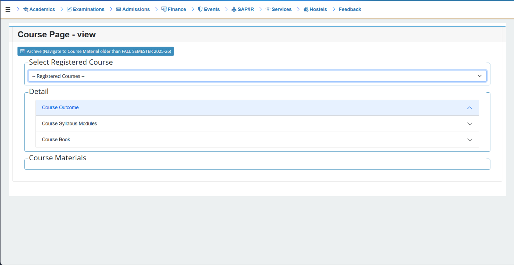
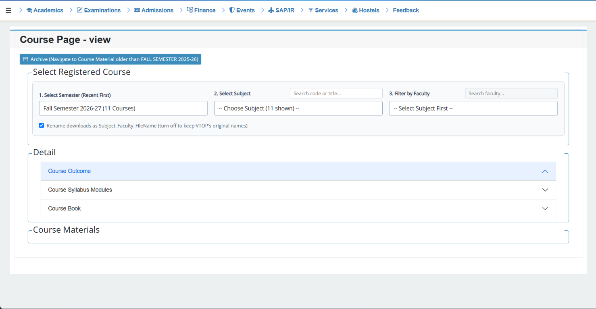

# VTOP Course Page Filter

A small browser extension that cleans up VTOP's **Course Page Consolidated** screen.

VTOP puts every course from every semester into one long dropdown, and the materials table mixes files from many professors across 15–25 pages. This extension fixes that:

1. **Semester dropdown**: newest semester first, with the number of courses in each.
2. **Subject dropdown with live search**: shows only the courses of the chosen semester. Type a code or title to narrow the list.
3. **Faculty dropdown with live search**: lists every professor who uploaded material for that subject, **across all pages of the table**, not just page 1. Pick one and the table shows only that professor's files.

## Before and after

| Before (default VTOP) | After (with the extension) |
|---|---|
|  |  |

## Install (about 1 minute)

Works on Chrome, Edge, Brave, and other Chromium browsers on a laptop or desktop. Pick **one** of the two options below.

### Option A: Download the ZIP (simplest)

1. Click the green **Code** button on this page, then **Download ZIP**.
2. Unzip it. You should see a folder containing `manifest.json` and `content.js`.

### Option B: Clone with Git (easiest to update later)

If you have [Git](https://git-scm.com/downloads) installed, open a terminal in the folder where you want to keep the extension and run:

```bash
git clone https://github.com/kamran2908/vtop-course-filter.git
```

This creates a `vtop-course-filter` folder containing `manifest.json` and `content.js`. When a new version comes out, you only need to run `git pull` inside that folder (see [Updating](#updating)).

### Then load it into your browser (both options)

1. Open `chrome://extensions` (in Edge: `edge://extensions`).
2. Turn on **Developer mode** (top right).
3. Click **Load unpacked** and select the folder that directly contains `manifest.json` (the unzipped folder, or the cloned `vtop-course-filter` folder).
4. Open VTOP, go to **Academics → Course Page Consolidated**, and press **Ctrl + Shift + R** to refresh.

You should now see three dropdowns above the course materials.

## How to use

1. Choose a **semester**.
2. Choose a **subject** (use the small search box to find it quickly).
3. Wait a moment while VTOP loads the materials. The **faculty** dropdown fills in automatically.
4. Pick a professor, or type their name in the faculty search box. The table filters instantly.

## Updating

This extension does not update itself. When a new version is released, follow the option that matches how you installed it.

### If you cloned with Git

1. Open a terminal inside the `vtop-course-filter` folder.
2. Run:

```bash
git pull
```

3. Go to `chrome://extensions` and click the **reload** icon on the extension's card.
4. Refresh VTOP with Ctrl + Shift + R.

You do not need to load the extension again. The folder stays the same, so only the reload step is needed.

### If you downloaded the ZIP

1. Download the new ZIP from the [Releases page](https://github.com/kamran2908/vtop-course-filter/releases).
2. Replace the old folder's files with the new ones.
3. Go to `chrome://extensions` and click the **reload** icon on the extension's card.
4. Refresh VTOP with Ctrl + Shift + R.

## Is it safe?

You can read all the code yourself. It is two short files, and nothing is hidden or minified.

- It runs **only** on `https://vtop.vit.ac.in/vtop/*`.
- It makes **no network requests**. Nothing is sent anywhere.
- It does **not** read, store, or transmit your password, cookies, marks, or any personal data.
- It only rearranges what VTOP already shows on the Course Page Consolidated screen: it reads the course dropdown and the materials table, and adds filter controls.
- It requests **no special browser permissions**.

## Troubleshooting

- **Nothing changed on VTOP.** Make sure the extension is switched on in `chrome://extensions`, then hard-refresh VTOP (Ctrl + Shift + R).
- **"Manifest file is missing" when loading.** You selected the wrong folder. Pick the folder that directly contains `manifest.json`, not its parent folder.
- **`git pull` says you have local changes.** You edited a file in the folder. Run `git stash` and then `git pull`, or re-clone the repo.
- **`git pull` says local changes would be overwritten.** You edited a file in the folder. Run `git stash` and then `git pull` again, or re-clone the repo.
- **A "disable developer mode extensions" popup appears when Chrome starts.** This is normal for extensions loaded outside the Web Store. You can dismiss it.
- **Faculty list is empty or incomplete.** Wait a couple of seconds after choosing the subject. If it still looks wrong, open an Issue (see below).
- **Stopped working after a VTOP update.** VIT may have changed the page layout. Please open an Issue.

## Reporting a problem

Open an [Issue](https://github.com/kamran2908/vtop-course-filter/issues) and include:

- A screenshot of the page.
- Your browser and version.
- Open the browser console (press F12, then the **Console** tab) and copy any line that starts with `[VTOP Filter]`.

## Known limitations

- Desktop browsers only. Chrome on phones does not support extensions.
- If VIT redesigns VTOP, the extension may need an update.

## Disclaimer

This is an independent student project. It is **not affiliated with, endorsed by, or supported by VIT or VTOP**. It does not bypass any login or access any data you cannot already see. Use it at your own discretion.

## License

[MIT](LICENSE)